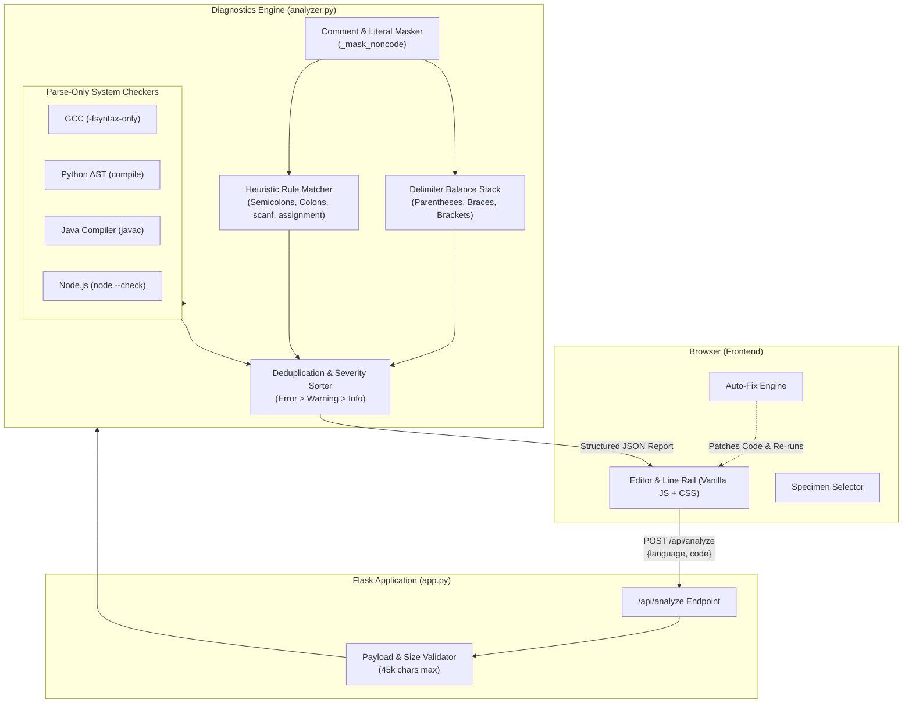

<div align="center">

# ⚡ Syntax Ledger
### *Interactive Multi-Language Compiler Error Detector & Diagnostic Workbench*

[](https://www.python.org/)
[](https://flask.palletsprojects.com/)
[](https://github.com/)
[](LICENSE)
[](#-zero-execution-security-model)
[](#-test-suite--quality-assurance)

<br />

<p align="center">
  <b>Trace the fault, then understand the fix.</b><br />
  A high-performance educational diagnostic desk and compiler-design laboratory.<br />
  Inspects <b>C, Python, Java, and JavaScript</b> with synchronized line-tracking, real-time AST/heuristic analysis, plain-language error explanations, and one-click smart remediation.
</p>

[Explore Features](#-key-features) •
[Quickstart](#-quickstart--installation) •
[Architecture](#-system-architecture) •
[API Documentation](#-rest-api-reference) •
[Security](#-zero-execution-security-model)

---

</div>

## 📑 Table of Contents

- [Overview](#-overview)
- [Key Features](#-key-features)
- [Zero-Execution Security Model](#-zero-execution-security-model)
- [Workbench UI & Specimen Trails](#-workbench-ui--specimen-trails)
- [System Architecture](#-system-architecture)
- [Diagnostic Capabilities & Error Catalog](#-diagnostic-capabilities--error-catalog)
- [Quickstart & Installation](#-quickstart--installation)
  - [Prerequisites](#prerequisites)
  - [Installation Steps](#installation-steps)
  - [Optional System Compilers](#optional-system-compilers)
- [REST API Reference](#-rest-api-reference)
- [Keyboard Shortcuts](#-keyboard-shortcuts)
- [Test Suite & Quality Assurance](#-test-suite--quality-assurance)
- [Repository Hygiene & API Keys Security](#-repository-hygiene--api-keys-security)
- [Extending for Compiler Design Projects](#-extending-for-compiler-design-projects)
- [Contributing & License](#-contributing--license)

---

## 💡 Overview

**Syntax Ledger** is an educational, production-ready static analysis workbench tailored for students, educators, and developers studying **compiler design, programming languages, and static code verification**.

Traditional compilers often emit cryptic, cascade-heavy diagnostics that overwhelm learners. **Syntax Ledger** bridges this gap by combining:
1. **Guided Heuristics Engine**: Rule-based lexical, token delimiter, and beginner semantic inspections designed to pinpoint root causes.
2. **Native Parse-Only Compilers**: Seamlessly integrates with GCC (`-fsyntax-only`), Python AST (`compile`), Java (`javac -proc:none`), and Node.js (`node --check`) when installed locally.
3. **Interactive Annotation Desk**: A dual-pane retro-modern visual ledger that highlights exact error spans, scrolls to offending lines, and offers **instant, one-click automated fixes**.

> [!IMPORTANT]
> **Safety Guarantee:** The application **never executes submitted code**. Programs are evaluated purely via syntax parsing, token streaming, and AST inspection inside secure temporary sandboxes with automatic lifecycle teardown.

---

## ✨ Key Features

- 🌐 **Four First-Class Languages**: Full static diagnostic pipelines for **C (C11)**, **Python 3**, **Java**, and **JavaScript (ES6+)**.
- 🛡️ **Zero-Execution Sandbox**: Strict isolation preventing accidental execution or malicious script payloads.
- ⚡ **Real-Time Line-Rail Synchronization**: Custom code editor with dynamic line numbering, gutter indicators, and scroll-locking.
- 🛠️ **Smart One-Click Remediation**: Emits declarative code patches (`{"line": N, "replacement": "..."}`) that users can apply directly with a single click.
- 🧪 **Interactive Specimen Trails**: Built-in test specimens for every language illustrating syntax errors, input handling mistakes, and semantic confusion (e.g., assignment inside conditions).
- 🔌 **Lightweight RESTful API**: Fast JSON API endpoint (`/api/analyze`) with strict payload validation, size quotas (45,000 characters / 60 KB), and standard HTTP error semantics.
- ⌨️ **Developer Keyboard Ergonomics**: Full keyboard navigation, including `Ctrl` + `Enter` analysis trigger, `Tab` indentation handling, and arrow/enter diagnostic card selection.
- 📦 **Zero Heavy Dependencies**: Built solely on standard Python 3 libraries and Flask 3.0+. No heavy databases or external runtime requirements.

---

## 🔒 Zero-Execution Security Model

```
   ┌──────────────────────────────────────────────────────────────┐
   │                     Incoming Source Code                     │
   └──────────────────────────────┬───────────────────────────────┘
                                  ▼
               [ 45k Char / 60KB Payload Guard ]
                                  │
                                  ▼
         ┌──────────────────────────────────────────────────┐
         │              Static Inspection Only              │
         │  • Python:   compile(source, 'exec') (AST only)   │
         │  • C:        gcc -fsyntax-only -std=c11          │
         │  • Java:     javac -proc:none -Xlint:none        │
         │  • Node.js:  node --check                        │
         └──────────────────────────────────────────────────┘
                                  │
                                  ▼
             ❌ ZERO Subprocess Execution of Binaries
             ⏱️ 4.0-Second Timeout on Linter Spawns
             🧹 Automatic Scratch Directory Cleanup
```

Syntax Ledger enforces strict security controls:
- **No Code Execution**: Submissions are never run. Linters are exclusively invoked with syntax-only or compile-only flags (`-fsyntax-only`, `--check`, `-proc:none`).
- **Resource Protection**: Maximum submission payload is capped at 60 KB (`MAX_CONTENT_LENGTH`) and string length is capped at 45,000 characters to prevent ReDoS (Regular Expression Denial of Service).
- **Subprocess Quarantine**: External processes are constrained by a strict 4-second timeout (`subprocess.TimeoutExpired`).
- **Ephemeral Storage**: Java and Node temporary source files are instantiated inside isolated temporary directories and deleted immediately upon analysis completion.

---

## 🖥️ Workbench UI & Specimen Trails

The application delivers an interface styled like an annotated engineering ledger:

```
┌─────────────────────────────────────────────────────────────────────────────┐
│  SYNTAX LEDGER             [●] Compiler Design Study Tool                   │
├─────────────────────────────────────────────────────────────────────────────┤
│  SOURCE LISTING                         ANNOTATION MARGIN                   │
│  [ Language: C ▼ ] [Copy] [Clear]       [ 1 Error ] [ 1 Warning ]           │
│  ┌───┬────────────────────────────────┐ ┌─────────────────────────────────┐ │
│  │ 1 │ #include <stdio.h>             │ │ [!] Line 4 · H101 (error)       │ │
│  │ 2 │                                │ │ Statement missing semicolon     │ │
│  │ 3 │ int main(void) {               │ │ ↳ End declaration with ';'      │ │
│  │ 4 │   int total = 10               │ │ [ Apply suggestion: '10;' ]     │ │
│  │ 5 │   if (total = 10) {            │ ├─────────────────────────────────┤ │
│  │ 6 │     printf("%d\n", total);     │ │ [▲] Line 5 · H401 (warning)     │ │
│  │ 7 │   }                            │ │ Assignment inside if condition  │ │
│  │ 8 │   return 0;                    │ │ ↳ Use '==' instead of '='       │ │
│  │ 9 │ }                              │ │ [ Apply suggestion: '==' ]      │ │
│  └───┴────────────────────────────────┘ └─────────────────────────────────┘ │
│  Ctrl + Enter to run analysis                     [ STRUCTURE LOOKS SOUND ] │
└─────────────────────────────────────────────────────────────────────────────┘
```

### Guided Specimen Trails (Included for each language)
1. **01 · Syntax Trail**: Highlights missing closing delimiters, unclosed braces/parentheses, or omitted termination tokens (e.g., semicolons in C/Java, colons in Python).
2. **02 · Input Trail**: Demonstrates correct memory access patterns (e.g., `scanf("%d", &var)` pointer addressing vs scalar value passing in C).
3. **03 · Condition Trail**: Flags unintended assignment operators (`=`) used inside conditional expressions (`if (x = 5)`), suggesting comparison operators (`==` / `===`).

---

## 🏗️ System Architecture



---

## 📊 Diagnostic Capabilities & Error Catalog

Syntax Ledger organizes diagnostics by language and category:

### 1. C Language (`c`)
| Diagnostic Code | Severity | Description | Guided Suggestion |
| :--- | :--- | :--- | :--- |
| `H101` | **Error** | Statement missing trailing semicolon | Appends `;` to the declaration/statement |
| `H102` | **Error** | Unexpected closing delimiter (`)`, `]`, `}`) | Identifies unmatched bracket or parenthesis |
| `H103` | **Error** | Unclosed delimiter | Locates opening delimiter and offers closing token |
| `H201` | **Error** | Malformed `#include` directive | Detects missing `#` before `include` |
| `H202` | **Error** | Incomplete header delimiter | Detects missing `>` or `"` closing header name |
| `H401` | **Warning** | Assignment inside `if` condition | Suggests replacing `=` with equality test `==` |
| `H402` | **Warning** | `scanf` missing variable address operator | Replaces `var` with `&var` for scalar parameters |
| `H403` | **Warning** | Missing `main` entry point | Recommends `int main(void)` declaration |
| `C101` - `C302` | **Compiler** | GCC native compiler diagnostics | Surfaced when GCC is installed on host |

### 2. Python (`python`)
| Diagnostic Code | Severity | Description | Guided Suggestion |
| :--- | :--- | :--- | :--- |
| `PYH101` | **Error** | Missing colon on block header | Appends `:` to `if`, `for`, `def`, `class`, etc. |
| `PYH102` | **Warning** | JS-style `function` keyword | Recommends replacing `function` with `def` |
| `PY101` | **Error** | Python parser SyntaxError | Pinpoints syntax violation via AST compiler |
| `PY102` | **Error** | Missing `:` in block construct | AST-detected missing colon |
| `PY103` | **Error** | Unterminated string or delimiter | Identifies unclosed quotes or brackets |
| `PY104` | **Error** | Expected indented block | Explains Python whitespace scoping rules |

### 3. Java (`java`)
| Diagnostic Code | Severity | Description | Guided Suggestion |
| :--- | :--- | :--- | :--- |
| `JH101` | **Error** | Java statement missing semicolon | Appends `;` to statements and variable definitions |
| `JH401` | **Warning** | Assignment inside `if` condition | Replaces `=` with `==` |
| `JH402` | **Warning** | Missing `public static void main` method | Explains application entry point requirement |
| `J101` - `J301` | **Compiler** | `javac` parse diagnostics | Surfaced when JDK is available on host |

### 4. JavaScript (`javascript`)
| Diagnostic Code | Severity | Description | Guided Suggestion |
| :--- | :--- | :--- | :--- |
| `JSH101` | **Warning** | Missing statement semicolon | Suggests explicit `;` delimiter |
| `JSH401` | **Warning** | Assignment inside `if` condition | Replaces `=` with strict comparison `===` |
| `JS101` - `JS102`| **Compiler** | `node --check` syntax diagnostics | Surfaced when Node.js is installed on host |

---

## 🚀 Quickstart & Installation

### Prerequisites
- **Python 3.10+** (Python 3.10, 3.11, or 3.12 recommended)
- **pip** (Python package installer)

### Installation Steps

1. **Clone the Repository**:
   ```bash
   git clone https://github.com/your-username/syntax_error_detector.git
   cd syntax_error_detector
   ```

2. **Create & Activate a Virtual Environment**:
   - **Linux / macOS**:
     ```bash
     python3 -m venv .venv
     source .venv/bin/activate
     ```
   - **Windows (PowerShell)**:
     ```powershell
     python -m venv .venv
     .venv\Scripts\Activate.ps1
     ```
   - **Windows (Command Prompt)**:
     ```cmd
     python -m venv .venv
     .venv\Scripts\activate.bat
     ```

3. **Install Dependencies**:
   ```bash
   pip install --upgrade pip
   pip install -r requirements.txt
   ```

4. **Initialize Environment Variables (Optional)**:
   ```bash
   # Copy template to .env (already protected in .gitignore)
   cp .env.example .env
   ```

5. **Start the Local Web Server**:
   ```bash
   python app.py
   ```

6. **Open in Browser**:
   Navigate to **[http://127.0.0.1:5000](http://127.0.0.1:5000)** in any modern browser.

---

### Optional System Compilers

Python AST checking is **built-in** and works out of the box. To enable native compiler messages for other languages, install any of the following optional toolchains:

| Tool | Languages | Ubuntu / Debian | macOS (Homebrew) | Windows |
| :--- | :--- | :--- | :--- | :--- |
| **GCC** | C | `sudo apt install build-essential` | `xcode-select --install` | Install MinGW-w64 / MSYS2 |
| **JDK (javac)** | Java | `sudo apt install default-jdk` | `brew install openjdk` | Install OpenJDK / Oracle JDK |
| **Node.js** | JavaScript | `sudo apt install nodejs` | `brew install node` | Install from [nodejs.org](https://nodejs.org) |

> [!TIP]
> If an external tool is not installed, Syntax Ledger automatically falls back to its robust built-in heuristic engine without interruption.

---

## 📡 REST API Reference

Syntax Ledger provides a programmatic JSON API for automated grading, CLI tools, or CI/CD pipelines.

### `POST /api/analyze`

Analyzes source code text and returns a list of diagnostics with repair suggestions.

#### Request Headers
```http
Content-Type: application/json
```

#### Request Body
```json
{
  "language": "c",
  "code": "#include <stdio.h>\nint main(void) {\n  int score = 10\n  return 0;\n}"
}
```

#### Response (`200 OK`)
```json
{
  "diagnostics": [
    {
      "code": "H101",
      "column": 17,
      "fix": {
        "label": "Add semicolon",
        "line": 3,
        "replacement": "  int score = 10;"
      },
      "line": 3,
      "message": "This declaration or statement does not end with `;`.",
      "severity": "error",
      "source_line": "  int score = 10",
      "suggestion": "Place a semicolon at the end of the statement.",
      "title": "Statement may be missing a semicolon"
    }
  ],
  "summary": {
    "engine": "GCC + guided heuristics",
    "errors": 1,
    "language": "c",
    "language_label": "C",
    "warnings": 0
  }
}
```

#### Error Responses
- **`400 Bad Request`**: Missing body, non-string code, or unsupported language.
  ```json
  { "error": "Choose one of the supported languages: C, Python, Java, or JavaScript." }
  ```
- **`413 Content Too Large`**: Source exceeds 45,000 characters or 60 KB payload.
  ```json
  { "error": "For a responsive study session, analyze at most 45,000 characters at once." }
  ```

#### Example cURL Request
```bash
curl -X POST http://127.0.0.1:5000/api/analyze \
  -H "Content-Type: application/json" \
  -d '{"language": "python", "code": "def calculate(a, b)\n    return a + b\n"}'
```

---

## ⌨️ Keyboard Shortcuts

| Shortcut | Context | Action |
| :--- | :--- | :--- |
| <kbd>Ctrl</kbd> + <kbd>Enter</kbd> (or <kbd>Cmd</kbd> + <kbd>Enter</kbd>) | Code Editor | Trigger source review immediately |
| <kbd>Tab</kbd> | Code Editor | Insert 2-space soft tab indentation |
| <kbd>Click</kbd> on Diagnostic Card | Annotation Margin | Highlights line & scrolls editor to exact location |
| <kbd>Enter</kbd> or <kbd>Space</kbd> | Diagnostic Card Focus | Jumps cursor directly to flagged line |

---

## 🧪 Test Suite & Quality Assurance

Syntax Ledger includes a comprehensive regression and API test suite.

Run all tests via Python's `unittest` runner:

```bash
python -m unittest discover -s tests -v
```

### Test Coverage Highlights:
- ✅ `test_detects_missing_semicolon`: Verifies C statement semicolon detection (`H101`).
- ✅ `test_detects_unclosed_brace`: Tests delimiter balance stack on unclosed `{` (`H103`).
- ✅ `test_detects_malformed_include`: Checks preprocessor directive regex (`H201`).
- ✅ `test_detects_scanf_address_warning`: Validates pointer vs scalar warning for `scanf` (`H402`).
- ✅ `test_clean_program_has_no_heuristic_errors`: Ensures clean code produces 0 false positives.
- ✅ `test_detects_python_missing_colon`: Verifies Python block colon detection (`PYH101`/`PY102`).
- ✅ `test_detects_java_missing_semicolon`: Verifies Java statement semicolon checking (`JH101`).
- ✅ `test_detects_javascript_assignment_condition`: Verifies JS assignment in condition (`JSH401`).
- ✅ `test_api_accepts_each_supported_language`: Tests API response across all supported languages.
- ✅ `test_api_rejects_unsupported_language`: Asserts 400 rejection for unsupported language strings.

---

## 🔐 Repository Hygiene & API Keys Security

This project adheres strictly to **senior-developer repository security standards**:

```
.
├── .gitignore          # Comprehensive rules protecting API keys, secrets & build artifacts
├── .env.example        # Environment variable schema template (safe to commit)
└── .env                # Ignored by git — contains actual local secrets
```

### Gitignore Coverage
- **Environment & Secrets**: `.env`, `.env.*`, `*.key`, `*.pem`, `*.cert`, `*.crt`, `*.pfx`, `token.json`, `credentials.json`, `secrets/`
- **Exclusion Allowlist**: Explicitly allows `.env.example` and `.env.template` so collaborators have setup schemas
- **Python Caches**: `__pycache__/`, `*.py[cod]`, `.pytest_cache/`, `*.egg-info/`, `.coverage`
- **Virtual Environments**: `.venv/`, `venv/`, `env/`
- **IDEs & OS Artifacts**: `.vscode/`, `.idea/`, `.DS_Store`, `Thumbs.db`
- **Compiler Artifacts**: `*.o`, `*.obj`, `*.class`, `*.exe`, `*.tmp`

> [!TIP]
> Before committing changes to GitHub, verify that no secret files are tracked:
> ```bash
> git status --ignored
> ```

---

## 🧭 Project Directory Structure

```text
syntex_error_detector/
├── .env.example              # Environment variables template
├── .gitignore                # Production-grade gitignore with API key protection
├── README.md                 # Interactive documentation and architectural manual
├── requirements.txt          # Python runtime dependencies (Flask >= 3.0)
│
├── app.py                    # Flask HTTP application server and REST endpoint
├── analyzer.py               # Core diagnostics engine (heuristics + compiler dispatch)
│
├── templates/
│   └── index.html            # Workbench UI shell and responsive markup
│
├── static/
│   ├── app.js                # Client logic: rail sync, keyboard handlers, auto-fix
│   └── style.css             # Architectural styling: themes, cards, animations
│
└── tests/
    ├── test_analyzer.py      # Core parser and heuristic regression tests
    └── test_api.py           # REST API endpoint and validation tests
```

---

## 🔬 Extending for Compiler Design Projects

The codebase is engineered with clear separation between **lexical masking**, **delimiter parsing**, and **diagnostic generation**. Here are natural extensions for an academic compiler-design curriculum:

1. **Add a Full Tokenizer (Lexer)**:
   - Introduce a structured `tokenize(source, language)` generator producing a stream of `Token(type, value, line, column)` objects.
2. **Build an Abstract Syntax Tree (AST)**:
   - Replace regex heuristics with recursive-descent parsing or parser generators (e.g., ANTLR, Lark, or PLY).
3. **Symbol Table & Scope Resolution**:
   - Implement hierarchical symbol tables to detect variable shadowing, type mismatches, and use-before-declaration errors.
4. **Intermediate Representation (IR)**:
   - Generate Three-Address Code (3AC) or LLVM IR from sound source files for visual code-generation study.

---

## 🤝 Contributing

Contributions are welcomed! Follow these standard open-source conventions:

1. **Fork the Repository**
2. **Create a Feature Branch**:
   ```bash
   git checkout -b feature/new-language-support
   ```
3. **Commit Your Changes**:
   ```bash
   git commit -m "feat: add Go language diagnostic heuristics"
   ```
4. **Ensure Regression Tests Pass**:
   ```bash
   python -m unittest discover -s tests -v
   ```
5. **Open a Pull Request** describing your additions and test cases.

---

## 📜 License

Distributed under the **MIT License**. See `LICENSE` for more information.

<div align="center">
  <sub>Built for students, educators, and compiler enthusiasts.</sub>
</div>
